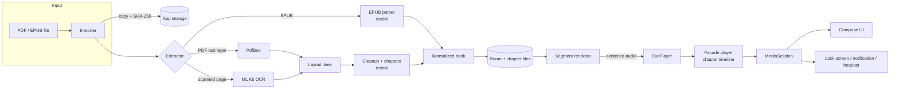
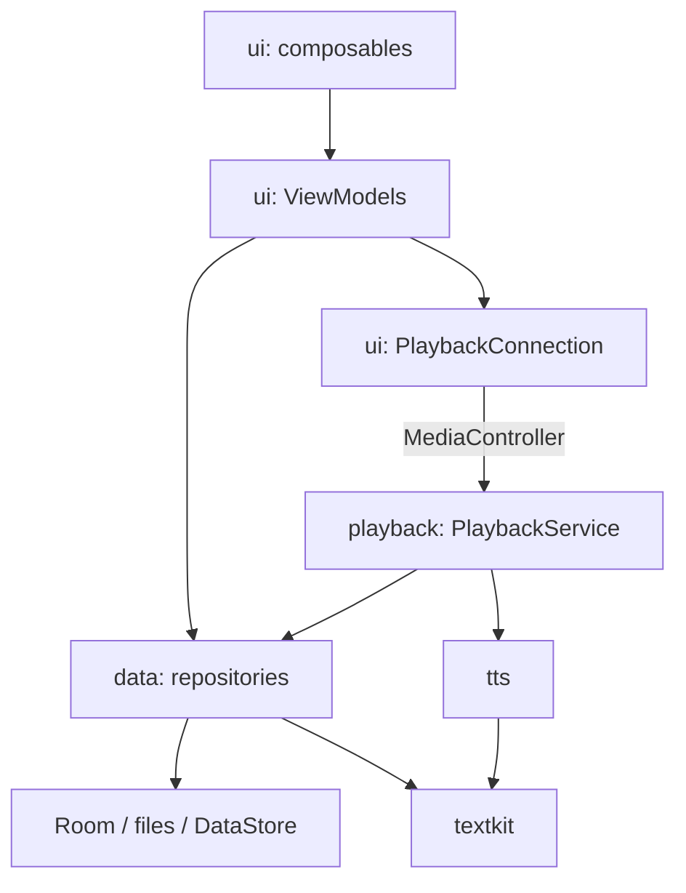
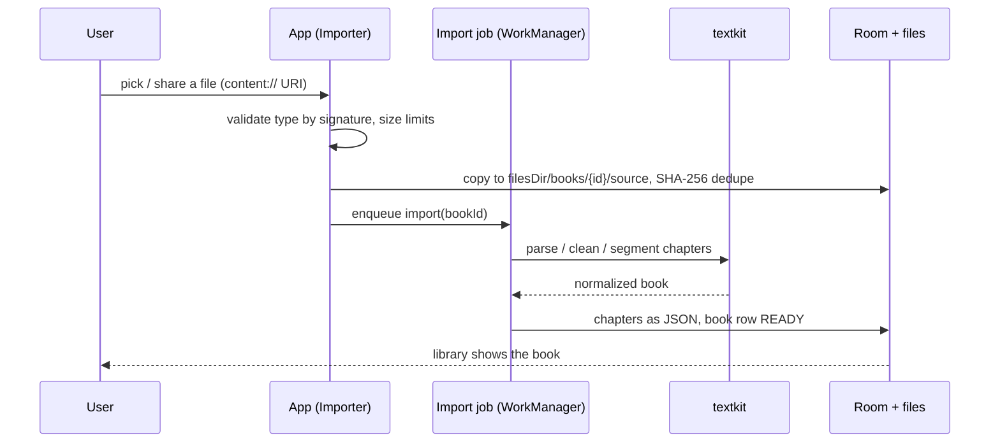
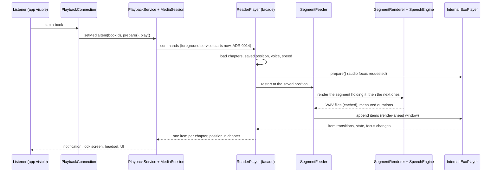
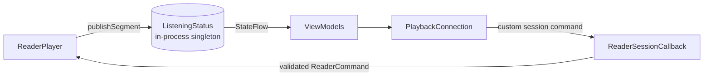

# Architecture

This document describes the target architecture and marks what is already
implemented. Update it in the same commit as any change to modules, layers or
flows. The reasons behind each choice are in the [ADRs](decisions/README.md).

## Overview

The core idea: **text becomes audio one sentence at a time, and a standard
media player plays that audio.** The same player therefore works for any voice
engine, and Media3 provides background playback, lock-screen and headset
controls, audio focus, "becoming noisy" handling and pitch-preserving speed.
See [ADR 0003](decisions/0003-sentence-audio-rendering-with-media3.md).

## Modules

| Module | Kind | Responsibility | Status |
|--------|------|----------------|--------|
| `:textkit` | Pure Kotlin/JVM library | Book model, EPUB parsing, PDF/OCR text cleanup, chapter detection, sentence segmentation, speech normalization, progress and time estimates | implemented (format detection, model, EPUB, text, estimates, PDF/OCR layout cleanup) |
| `:app` | Android application | UI, import, PDF/OCR adapters, TTS engines, rendering, playback service, persistence | in progress (shell, library, import, voices, playback) |

`:app` depends on `:textkit`; `:textkit` never depends on Android. Anything
that can be pure Kotlin goes to `:textkit` so it is fast to test
([ADR 0004](decisions/0004-pure-jvm-textkit-module.md)).

## Build facts

- Gradle 9.9 (wrapper with pinned checksum), AGP 9.5 with built-in Kotlin,
  Kotlin 2.4, KSP, Hilt; versions live in `gradle/libs.versions.toml`.
- `compileSdk` 37.2 (required by current AndroidX), `targetSdk` 37
  ([ADR 0014](decisions/0014-target-android-17.md)), `minSdk` 26;
  Java/Kotlin bytecode target 17.
- The Gradle daemon runs on a provisioned Temurin JDK 21
  (`gradle/gradle-daemon-jvm.properties`).
- Quality gates in `./gradlew check`: unit tests, Android Lint (warnings
  reviewed, missing translations are errors), detekt (`config/detekt/`),
  Spotless + ktlint with Compose rules.

## `:app` packages

Base package: `com.giovannimartins.rreader`.

| Package | Responsibility | Status |
|---------|----------------|--------|
| `data` | Room database (`db`), book file storage (`files`), library repository (`library`), DataStore settings (`settings`) | implemented |
| `importer` | `BookIntake` (picker/share/view URIs → signature check, size-limited copy, SHA-256 dedupe, book row), `ImportBookWorker` + `BookImportProcessor` (parse and persist), `BookParser` per format (`EpubBookParser`, `PdfBookParser`) | implemented |
| `pdf` | PdfBox text extraction (`PdfLayoutExtractor`: positioned lines, outline and document info within `PdfLimits`), `PdfRenderer` page rendering (`FirstPageCoverRenderer`: first page → JPEG cover), ML Kit OCR → layout lines | in progress (text-layer PDFs; OCR in Phase 4) |
| `tts` | `SpeechEngine` interface and `SystemTtsEngine` (multi-engine Android TTS → WAV), `AudioCache`, `WavInfo`, `SegmentRenderer` (segment → cached WAV, 300 MB LRU trim), `SpeakingRateTracker` (per-voice rate learned from rendered audio); later `SherpaOnnxEngine` | implemented (neural voices in Phase 5) |
| `playback` | `PlaybackService` (`MediaSessionService`, trusted controllers only), `ReaderPlayer` facade (chapter playlist over an internal ExoPlayer), `SegmentFeeder` (render-ahead window), `ChapterPlans`, `SeekTargets`, `PositionSaver`, `PlaybackRepository`, `ListeningStatus` (spoken segment for the UI), `ReaderCommands` (custom session commands); later the sleep timer | implemented (sleep timer in Phase 3) |
| `catalog` | Public-domain catalogue client and downloads | planned |
| `ui` | Compose screens, ViewModels, navigation, theme, design system; `ui/player`: `PlaybackConnection` (`MediaController` while the app is visible), mini player, full player with speed and chapters | in progress (shell, library, add book, voices, player) |
| `di` | Hilt modules (dispatchers, application scope, database, WorkManager) | implemented |

## Layering rules

- Composables only render state and emit events.
- ViewModels expose immutable UI state as `StateFlow` and call repositories
  or `PlaybackControls` (implemented by `PlaybackConnection` over a
  `MediaController`).
- Repositories own data access and map errors to sealed types.
- The playback service is the only owner of the player; the UI talks to it
  through a `MediaController`. Commands Media3 has no name for ("read from
  here") are custom session commands (`ReaderCommands`), and state it does
  not model (the segment being spoken) reaches the UI through
  `ListeningStatus` (see [Spoken segment and app commands](#spoken-segment-and-app-commands)).

## Key flows

### Import

### Playback

1. The UI connects a `MediaController` to `PlaybackService` while the app is
   visible and opens a book with `setMediaItem(bookId)`, `prepare()` and
   `play()`. The book resumes at the start of the segment that holds its
   saved reading position.
2. The `SegmentFeeder` plans each chapter with textkit's `SegmentPlanner`,
   applies `SpeechNormalizer` to each segment (skipping blank speech) and has
   the `SegmentRenderer` turn it into a WAV file in the audio cache. It keeps
   at least two minutes and four segments rendered ahead of the playing one,
   continuing into the next chapters.
3. Rendered segments are appended to the internal ExoPlayer's playlist; the
   pauses the voice leaves around sentences sound natural. If the internal
   player runs out of audio, the facade reports buffering and playback
   continues as soon as the next segment is queued.
4. The facade player exposes one item per chapter with a position and
   duration derived from characters and the voice's speaking rate (media
   time, ADR 0006). Seeks map to a reading position, then to the segment that
   holds it, and rebuild the internal playlist from there. ±15 s cross
   chapter boundaries and are clamped to the book; headset next/previous are
   ±15 s. The end of the book is `STATE_ENDED`.
5. The reading position is saved on every segment change, pause, stop and
   release, and (throttled) on seeks; the speed is saved in the settings.
6. The internal player handles audio focus (phone calls, other apps),
   "becoming noisy" (headphones unplugged) and a local wake lock; the facade
   mirrors the resulting pauses and suppressions.

### Spoken segment and app commands

- **State to the UI.** The facade publishes the segment being spoken
  (`SpokenSegment`: book, chapter, character range) in `ListeningStatus`, a
  Hilt singleton that the player and the ViewModels share. It changes when the
  internal player moves to another segment and as soon as a seek or the start
  position is resolved (before its audio is rendered), and clears when a book
  closes or the player is released. This works because the playback service
  runs in the app's own process (see Threading); moving it to another process
  would require publishing the same values as session extras instead. The UI
  only reads it: every change to playback still goes through the
  `MediaController`.
- **Commands from the UI.** `ReaderCommands` encodes commands Media3 has no
  name for as custom session commands: `READ_FROM` carries a reading
  position (chapter, offset) and plays from the start of the segment that
  holds it. `ReaderSessionCallback` grants them only to controllers that run
  as this app (same uid, which the system reports), validates the arguments
  and passes a typed `ReaderCommand` to `ReaderPlayer.handle`; invalid
  requests get `ERROR_BAD_VALUE`, requests that do not apply (no book open)
  get `ERROR_INVALID_STATE`.

## Persistence

| What | Where | Notes |
|------|-------|-------|
| Books, chapters metadata, reading positions, per-book voice | Room (`rreader.db`) | Schema versioned; exported to `app/schemas/` for migration tests |
| Settings (default voice, speed, text size) | DataStore | |
| Original file | `filesDir/books/{bookId}/source.{pdf,epub}` | Private app storage |
| Normalized chapters | `filesDir/books/{bookId}/chapters/{index}.txt` | UTF-8 text, immutable after import |
| Covers | `filesDir/books/{bookId}/cover` | Raw image bytes as extracted or rendered |
| Rendered audio | `cacheDir/tts/{bookId}/{voiceHash}/{chapter}-{start}-{end}.wav` | Trimmed to 300 MB, least recently used first, keeping the render-ahead window; safe to delete |

## Invariants

- A **reading position** is `(chapterIndex, charOffset)` into the normalized
  chapter text ([ADR 0006](decisions/0006-reading-position-as-chapter-and-char-offset.md)).
  Times and percentages are estimates derived from it.
- **Normalized text is immutable after import.** If the normalization
  algorithm changes, existing books keep their text (or a migration re-maps
  positions explicitly).
- **Untrusted input never escapes validation:** archive entry names are never
  used as file paths, XML is parsed without DTDs, parsing runs with limits.
- **No network access** happens without an explicit user action.

## Threading

- Coroutines with injected dispatchers: `IO` for files and database,
  `Default` for parsing and segmentation, `Main` for UI.
- Imports, OCR and long pre-rendering (for example of slow neural voices)
  run in WorkManager so they survive process death. The render-ahead window
  of the playing book runs inside the playback service instead.
- Parsing a book blocks, so `BookImportProcessor` runs it with
  `runInterruptible`: a cancelled import interrupts the thread, and the PDF
  extractor, which checks between pages and glyphs, stops.
- The playback service runs in the main process as a foreground service of
  type `mediaPlayback`. The facade and the internal ExoPlayer live on the
  main looper; chapter text is read on `IO`, planned on `Default`, and
  rendering results are applied back on the main looper.

## Security

See [security.md](security.md) for the threat model, trust boundaries and the
security requirements each component must meet.
