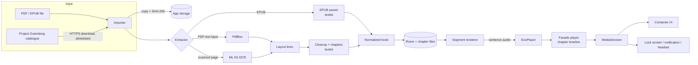
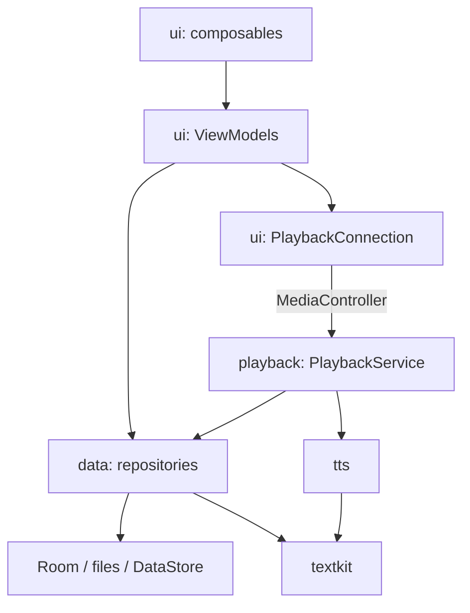
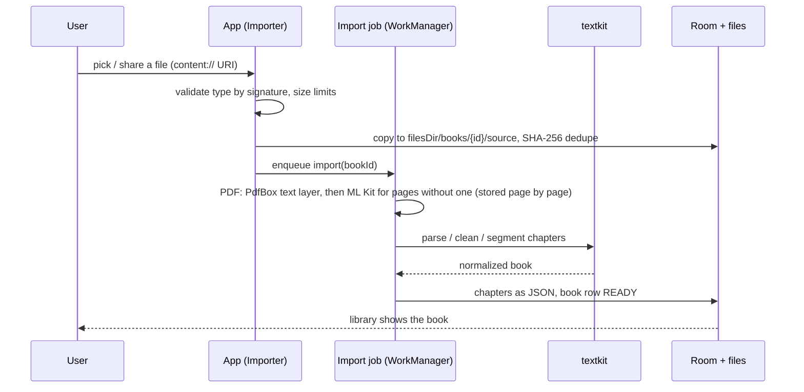
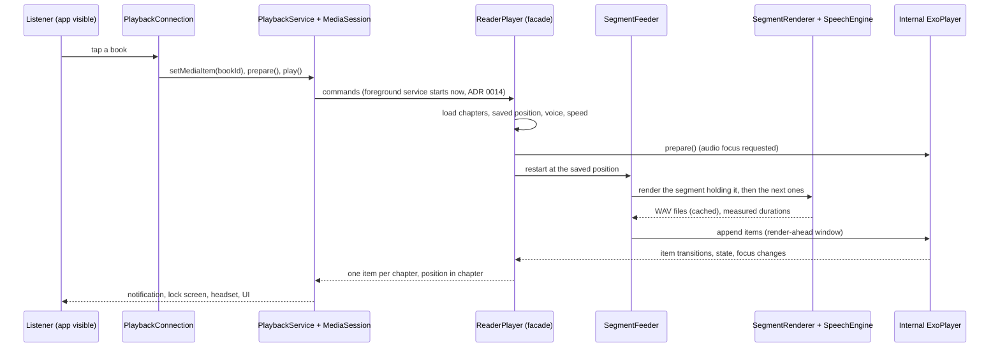
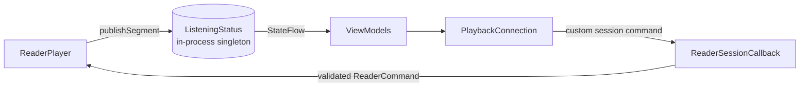
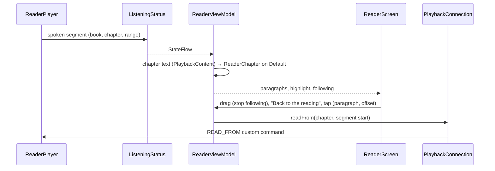
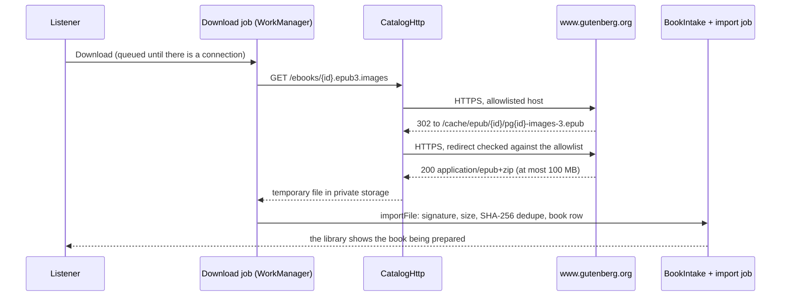

# Architecture

This document describes the target architecture and marks what is already
implemented. Update it in the same commit as any change to modules, layers or
flows. The reasons behind each choice are in the [ADRs](decisions/README.md).

## Overview

The core idea: **text becomes audio one sentence at a time, and a standard
media player plays that audio.** The same player therefore works for any voice
engine, and Media3 provides background playback, lock-screen and headset
controls, audio focus, "becoming noisy" handling and pitch-preserving speed.
See [ADR 0003](decisions/0003-sentence-audio-rendering-with-media3.md).

## Modules

| Module | Kind | Responsibility | Status |
|--------|------|----------------|--------|
| `:textkit` | Pure Kotlin/JVM library | Book model, EPUB parsing, PDF/OCR text cleanup, chapter detection, sentence segmentation, speech normalization, progress and time estimates | implemented (format detection, model, EPUB, text, estimates, PDF/OCR layout cleanup) |
| `:app` | Android application | UI, import, PDF/OCR adapters, TTS engines, rendering, playback service, persistence | in progress (shell, library, import, voices, playback) |

`:app` depends on `:textkit`; `:textkit` never depends on Android. Anything
that can be pure Kotlin goes to `:textkit` so it is fast to test
([ADR 0004](decisions/0004-pure-jvm-textkit-module.md)).

## Build facts

- Gradle 9.9 (wrapper with pinned checksum), AGP 9.5 with built-in Kotlin,
  Kotlin 2.4, KSP, Hilt; versions live in `gradle/libs.versions.toml`.
- `compileSdk` 37.2 (required by current AndroidX), `targetSdk` 37
  ([ADR 0014](decisions/0014-target-android-17.md)), `minSdk` 26;
  Java/Kotlin bytecode target 17.
- APKs are split per ABI (`arm64-v8a` for phones, `x86_64` for the emulator)
  because ML Kit ships native code.
- The Gradle daemon runs on a provisioned Temurin JDK 21
  (`gradle/gradle-daemon-jvm.properties`).
- Quality gates in `./gradlew check`: unit tests, Android Lint (warnings
  reviewed, missing translations are errors), detekt (`config/detekt/`),
  Spotless + ktlint with Compose rules.

## `:app` packages

Base package: `com.giovannimartins.rreader`.

| Package | Responsibility | Status |
|---------|----------------|--------|
| `data` | Room database (`db`), book file storage (`files`), library repository (`library`), DataStore settings and learned speaking rates (`settings`) | implemented |
| `importer` | `BookIntake` (picker/share/view URIs → signature check, size-limited copy, SHA-256 dedupe, book row), `ImportBookWorker` + `BookImportProcessor` (parse and persist; recognized pages deleted when the import ends), `BookParser` per format (`EpubBookParser`, `PdfBookParser`: text layer, then `PdfOcr` for scanned pages) taking a `ParseRequest` with an `ImportProgressListener`, `ImportJobs` (one unique WorkManager job per book: enqueue, cancel when the book is removed, observe progress), `ImportNotifications` (progress notification of the `dataSync` foreground service) | implemented |
| `pdf` | PdfBox text extraction (`PdfLayoutExtractor`: positioned lines, outline and document info within `PdfLimits`), `PdfRenderer` page rendering (`FirstPageCoverRenderer`: first page → JPEG cover; `PdfPageRasterizer`: pages → bitmaps for OCR within `OcrLimits`), text recognition behind `PageTextRecognizer` (`MlKitPageTextRecognizer`: bundled ML Kit Latin model → layout lines through textkit's `OcrPageLayout`), `PdfOcr` (recognizes the pictured pages without a usable text layer within `OcrLimits`, one page at a time app-wide through `OcrGate`, resumable through `OcrPageStore`) | in progress (text-layer PDFs; OCR in Phase 4) |
| `tts` | `SpeechEngine` interface and `SystemTtsEngine` (multi-engine Android TTS → WAV), `AudioCache`, `WavInfo`, `SegmentRenderer` (segment → cached WAV, 300 MB LRU trim), `SpeakingRateTracker` (per-voice rate learned from rendered audio, kept across restarts through `SpeakingRateStore`); later `SherpaOnnxEngine` | implemented (neural voices in Phase 5) |
| `playback` | `PlaybackService` (`MediaSessionService`, trusted controllers only), `ReaderPlayer` facade (chapter playlist over an internal ExoPlayer), `SegmentFeeder` (render-ahead window), `ChapterPlans`, `SeekTargets`, `PositionSaver`, `PlaybackRepository`, `ListeningStatus` (spoken segment and sleep timer for the UI), `ReaderCommands` (custom session commands), `SleepTimer` | implemented |
| `catalog` | Free public-domain catalogue (Project Gutenberg, [ADR 0017](decisions/0017-free-catalogue-from-project-gutenberg.md)): `CatalogHttp`, the app's only network client (HTTPS GETs through an `HttpTransport`, `UrlConnectionTransport` on `HttpsURLConnection`; every address and redirect checked by `CatalogHosts`; media type, size and redirect limits), `CatalogUserAgent`; `CuratedCatalog` (curated classics from an asset), `CatalogRepository` (OPDS search through `GutenbergEndpoints`, pages kept in memory by `SearchCache`), `CatalogDownloads` (`WorkManagerCatalogDownloads`: one unique `DownloadBookWorker` job per book, needing a connection) running `CatalogDownloader` (EPUB → temporary file → `BookIntake.importFile`), `NetworkStatus` (offline or not, from the system's default network) | implemented |
| `ui` | Compose screens, ViewModels, navigation, theme, design system; `ui/player`: `PlaybackConnection` (`MediaController` while the app is visible), mini player, full player with speed, chapters, time left and the sleep timer; `ui/library`: progress and time left (`LibraryTimeLeft`); `ui/reader`: follow-along reader (`ReaderViewModel`, `ReaderChapter`); `ui/components`: `BookCover`, time-left text (`timeLeft`); `ui/explore`: Explore tab (`ExploreViewModel`: curated classics, search, downloads, offline state) | in progress (shell, library, explore, add book, voices, player) |
| `di` | Hilt modules (dispatchers, application scope, database, WorkManager) | implemented |

## Layering rules

- Composables only render state and emit events.
- ViewModels expose immutable UI state as `StateFlow` and call repositories
  or `PlaybackControls` (implemented by `PlaybackConnection` over a
  `MediaController`).
- Repositories own data access and map errors to sealed types.
- The playback service is the only owner of the player; the UI talks to it
  through a `MediaController`. Commands Media3 has no name for ("read from
  here", the sleep timer) are custom session commands (`ReaderCommands`), and
  state it does not model (the segment being spoken, the sleep timer) reaches
  the UI through `ListeningStatus` (see [Spoken segment and app commands](#spoken-segment-and-app-commands)).

## Key flows

### Import

### Playback

1. The UI connects a `MediaController` to `PlaybackService` while the app is
   visible and opens a book with `setMediaItem(bookId)`, `prepare()` and
   `play()`. The book resumes at the start of the segment that holds its
   saved reading position, a little earlier when it was left more than five
   minutes ago (see [Resume rewind](#resume-rewind)).
2. The `SegmentFeeder` plans each chapter with textkit's `SegmentPlanner`,
   applies `SpeechNormalizer` to each segment (skipping blank speech) and has
   the `SegmentRenderer` turn it into a WAV file in the audio cache. It keeps
   at least two minutes and four segments rendered ahead of the playing one,
   continuing into the next chapters.
3. Rendered segments are appended to the internal ExoPlayer's playlist; the
   pauses the voice leaves around sentences sound natural. If the internal
   player runs out of audio, the facade reports buffering and playback
   continues as soon as the next segment is queued.
4. The facade player exposes one item per chapter with a position and
   duration derived from characters and the voice's speaking rate (media
   time, ADR 0006). Seeks map to a reading position, then to the segment that
   holds it, and rebuild the internal playlist from there. ±15 s cross
   chapter boundaries and are clamped to the book; headset next/previous are
   ±15 s. The end of the book is `STATE_ENDED`.
5. The reading position is saved on every segment change, pause, stop and
   release, and (throttled) on seeks; the speed is saved in the settings.
6. The internal player handles audio focus (phone calls, other apps),
   "becoming noisy" (headphones unplugged) and a local wake lock; the facade
   mirrors the resulting pauses and suppressions.

### Spoken segment and app commands

- **State to the UI.** The facade publishes the segment being spoken
  (`SpokenSegment`: book, chapter, character range) and the sleep timer
  (`SleepTimerState`) in `ListeningStatus`, a Hilt singleton that the player
  and the ViewModels share. It changes when the
  internal player moves to another segment and as soon as a seek or the start
  position is resolved (before its audio is rendered), and clears when a book
  closes or the player is released. This works because the playback service
  runs in the app's own process (see Threading); moving it to another process
  would require publishing the same values as session extras instead. The UI
  only reads it: every change to playback still goes through the
  `MediaController`.
- **Commands from the UI.** `ReaderCommands` encodes commands Media3 has no
  name for as custom session commands: `READ_FROM` carries a reading
  position (chapter, offset) and plays from the start of the segment that
  holds it; `SET_SLEEP_TIMER` carries a duration (up to 12 hours) or "end of
  chapter", and `CANCEL_SLEEP_TIMER` turns the timer off. `ReaderSessionCallback` grants them only to controllers that run
  as this app (same uid, which the system reports), except Media3's media
  notification controller, which relays notification actions that any app
  can send to the exported service; it validates the arguments and passes a
  typed `ReaderCommand` to `ReaderPlayer.handle`. Requests from any other
  controller get `ERROR_PERMISSION_DENIED`, invalid requests get
  `ERROR_BAD_VALUE`, requests that do not apply (no book open) get
  `ERROR_INVALID_STATE`. The session has a random id and the service hands it
  to trusted controllers only, so media buttons and notification actions that
  other apps send as start intents are ignored (SR-7).

### Follow-along reader

- The full player's "Text" button opens the reader over the player; back
  returns to the player. It shows the chapter being read: the spoken
  segment's chapter, else the player's current chapter.
- `ReaderChapter` splits the chapter text into paragraphs
  (`Chapter.paragraphRangesOf`) and plans its segments with the same
  `SegmentPlanner` as the player, on the `Default` dispatcher. The text is a
  `LazyColumn` with one item per paragraph, so long chapters scroll smoothly;
  only the paragraph being read carries an `AnnotatedString` highlight of the
  spoken segment (primary colour behind it).
- **Auto-follow**: while following, the highlighted line is kept between 10 %
  and 80 % of the screen and otherwise scrolled to 25 % (a far paragraph is
  jumped to first). A drag by the listener stops following (programmatic
  scrolls do not count); "Back to the reading" follows again and scrolls
  back. While not following, the chapter shown stays put even when the
  voice moves on to the next chapter.
- **Read from here**: a tap maps the character under the finger to the
  segment that holds it (or the next one between sentences) and sends
  `readFrom` with that segment's start, which plays from there. TalkBack
  users get "Read from here" on each paragraph (its first sentence). After
  reading from a chapter left behind, the reader stays on it until the voice
  gets there.
- **Text size**: A− and A+ step through 0.85×–2× (`ReaderTextScale`), saved
  as `readerTextScale` in the settings; sizes are in sp, so the system font
  scale applies on top.

### Resume rewind

After a long pause the listener has lost the thread, so listening resumes a
little before where it stopped (`ResumeRewind`):

- A pause is long when it lasted more than 5 minutes. `PauseClock` notes when
  listening stopped (pause, stop, failure, a focus loss, or the start of an
  interruption such as a phone call) on the facade's clock, which keeps
  counting while the phone sleeps.
- On resume after a long pause (play, or the end of a long interruption),
  the facade restarts the feeder with a rewind: the start is one segment
  earlier or 10 seconds of text (media time at 1.0×) earlier, whichever is
  the smaller rewind, and then, as always, the start of the segment that
  holds that point. It crosses chapter boundaries and never goes before the
  start of the book, so the first segment of a book just starts again.
- A book opened again (for example after the app was closed) applies the same
  rule to the time since its position was saved (`PlaybackBook.pausedFor`,
  from the position's `updated_at`), unless a chapter was asked for.
- Seeks, chapter jumps, "read from here" and opening another book forget the
  pause: listening then starts exactly where it was sent.

### Sleep timer

The `SleepTimer` lives in the facade player, inside the `mediaPlayback`
foreground service, so it works with the screen off and is allowed to change
the volume on Android 17 ([ADR 0014](decisions/0014-target-android-17.md)).

- **After a duration** (the player offers 5, 10, 15, 30, 45 and 60 minutes):
  the time runs only while audio plays (`isPlaying`), so pauses, phone calls
  and waits for rendered audio do not use it up. During the last 10 seconds
  the internal player's volume falls linearly to zero in 100 ms steps; then
  the facade pauses (saving the position) and only afterwards restores the
  full volume, so the next play starts at normal volume.
- **End of chapter**: the fade follows the audio left in the chapter being
  played (queued segment durations ÷ speed), known once the chapter's last
  segment is queued. Listening pauses when the internal player moves on to
  the next chapter, or when it runs out of rendered audio right at the end of
  a chapter. The end of the book turns the timer off.
- The timer is a listening-session setting: it keeps running when another
  book is opened, ends with the player, and is not persisted. Its state is
  published in `ListeningStatus` (the countdown in whole seconds).
- It is scheduled with Media3's `Clock`, which the facade receives
  (`Clock.DEFAULT` in the app), so tests drive it with a `FakeClock`.

### Catalogue

The Explore tab offers free public-domain books from Project Gutenberg
([ADR 0017](decisions/0017-free-catalogue-from-project-gutenberg.md)).

- **Curated classics.** `CuratedCatalog` reads
  `assets/catalog/curated.json`: 26 classics in Portuguese, each a Gutenberg
  ebook number with its title, author and a short description. Showing them
  needs no network.
- **Search.** `CatalogRepository.search` asks Gutenberg's OPDS search feed
  for one page (25 books) of `<words> l.pt`, the filter for books in
  Portuguese, through `CatalogHttp` (`application/atom+xml`, at most 1 MiB);
  textkit's `GutenbergFeedParser` reads it. The next page is asked for only
  when the listener wants more results, through the feed's `next` link once
  `CatalogHosts` accepts it. Pages stay in memory for 15 minutes
  (`SearchCache`, 20 pages). A missing or broken connection is `OFFLINE`; any
  other failure, `UNAVAILABLE`.
- **Download.** "Download" queues a unique `DownloadBookWorker` job for the
  ebook (`WorkManagerCatalogDownloads`) that runs only with a connection, so a
  book asked for offline downloads once the phone is back online.
  `CatalogDownloader` fetches the EPUB 3 into a temporary file in private
  storage and hands it to `BookIntake.importFile`, the intake of shared files:
  signature check, 300 MB limit, SHA-256 duplicate check (an already imported
  book is reported as such), book row and import job. A lost connection or a
  busy server (HTTP 429, 5xx) is retried with an exponential backoff from
  30 seconds, at most four attempts in all. The job publishes its
  percentage and ends with the book's id or a `DownloadFailure`, read back by
  ebook number as a `DownloadState`.
- **License.** The EPUB parser drops Gutenberg's header, credits and license
  (`GutenbergBoilerplate`), so listening starts with the book itself.
- **Screen.** `ExploreViewModel` combines the curated classics, the search
  (`SearchUiState`), the downloads by ebook number, leaving out books removed
  from the library since so they can be downloaded again, and
  `NetworkStatus`, which says when the phone is offline. Each book has one
  large "Download" button that becomes the download's progress, "Open in the
  library" or the reason it failed with "Try again". Showing the tab makes
  no request.

## Persistence

| What | Where | Notes |
|------|-------|-------|
| Books, chapters metadata, reading positions, per-book voice | Room (`rreader.db`) | Schema versioned; exported to `app/schemas/` for migration tests |
| Settings (default voice, speed, text size) | DataStore (`settings`) | |
| Learned speaking rates per voice, last voice that read | DataStore (`speaking_rates`, `SpeakingRatePreferences`) | Apart from the settings because they are measured, not chosen. Restored before the first book plays (`PlaybackRepository.load`) and for the library's time left; saved right after a change, then at most every 30 s |
| Original file | `filesDir/books/{bookId}/source.{pdf,epub}` | Private app storage |
| Normalized chapters | `filesDir/books/{bookId}/chapters/{index}.txt` | UTF-8 text, immutable after import |
| Covers | `filesDir/books/{bookId}/cover` | Raw image bytes as extracted or rendered |
| Recognized pages | `filesDir/books/{bookId}/ocr/{page}.json` | Lines text recognition read on a page and the time it took (versioned JSON); written as each page is read so a stopped import resumes, deleted when the import ends (ADR 0015) |
| Catalogue download in progress | `filesDir/imports/{uuid}.part` | The EPUB being received; deleted once the intake copied it into the book's folder, or when the download fails |
| Catalogue search pages | Memory only (`SearchCache`) | At most 20 pages, each for 15 minutes; search words are never written to disk |
| Rendered audio | `cacheDir/tts/{bookId}/{voiceHash}/{chapter}-{start}-{end}.wav` | Trimmed to 300 MB, least recently used first, keeping the render-ahead window; safe to delete |

## Invariants

- A **reading position** is `(chapterIndex, charOffset)` into the normalized
  chapter text ([ADR 0006](decisions/0006-reading-position-as-chapter-and-char-offset.md)).
  Times and percentages are estimates derived from it.
- **Normalized text is immutable after import.** If the normalization
  algorithm changes, existing books keep their text (or a migration re-maps
  positions explicitly).
- **Untrusted input never escapes validation:** archive entry names are never
  used as file paths, XML is parsed without DTDs, parsing runs with limits.
- **No network access** happens without an explicit user action, and only
  through `CatalogHttp`, over HTTPS to the allowlisted hosts (`CatalogHosts`,
  mirrored by the network security config, which trusts no other host).

## Threading

- Coroutines with injected dispatchers: `IO` for files and database,
  `Default` for parsing and segmentation, `Main` for UI.
- Imports, OCR, catalogue downloads and long pre-rendering (for example of
  slow neural voices) run in WorkManager so they survive process death;
  downloads also wait for a connection (`NetworkType.CONNECTED`). The
  render-ahead window of the playing book runs inside the playback service
  instead.
- While text recognition runs, the import job asks WorkManager to run it in
  its foreground service with the `dataSync` type and a progress
  notification; if the platform refuses (the job started in the background),
  it goes on as a normal job, which the system may stop and WorkManager runs
  again, resuming from the stored pages (ADR 0015). Progress goes through
  WorkManager (`setProgress`), observed through `ImportJobs`. One page at a
  time is drawn and recognized in the whole app (`OcrGate`).
- Parsing a book blocks, so `BookImportProcessor` runs it with
  `runInterruptible`: a cancelled import interrupts the thread, and the PDF
  extractor, which checks between pages and glyphs, and the EPUB parser,
  which checks at every element, stop. Anything else a parser or the storage
  throws ends the import as failed (out of memory or stack: "too complex";
  database or file errors: "could not be saved"; the rest: "damaged"), so a
  book never stays "being prepared" because of it. An import started ten
  times without ending, because the system kept stopping it or its process
  kept dying in it, is given up as too complex (`ImportBookWorker`).
- The playback service runs in the main process as a foreground service of
  type `mediaPlayback`. The facade and the internal ExoPlayer live on the
  main looper; chapter text is read on `IO`, planned on `Default`, and
  rendering results are applied back on the main looper.

## Security

See [security.md](security.md) for the threat model, trust boundaries and the
security requirements each component must meet.
