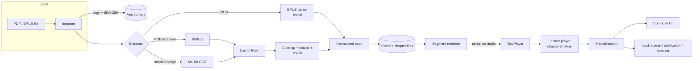
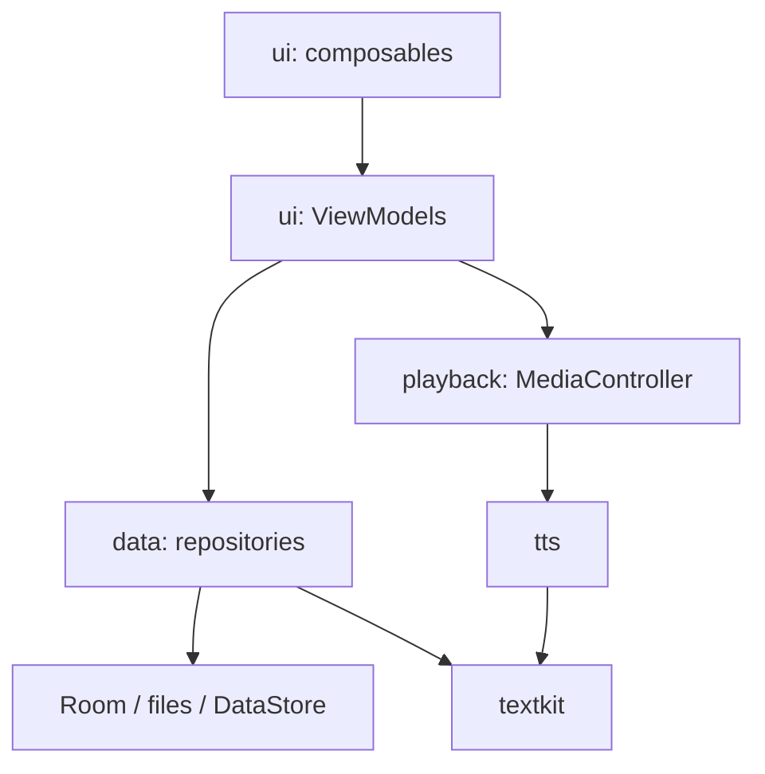
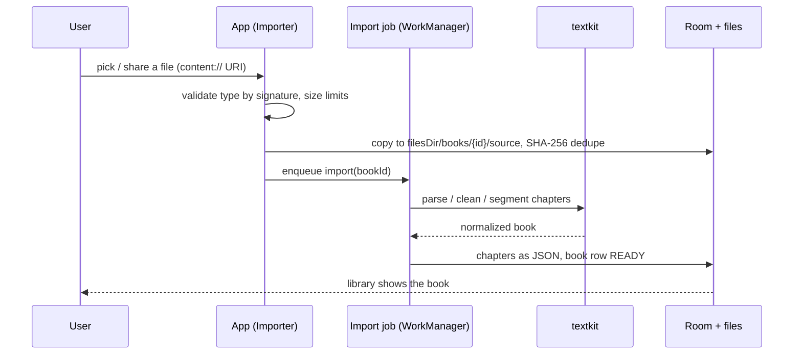

# Architecture

This document describes the target architecture and marks what is already
implemented. Update it in the same commit as any change to modules, layers or
flows. The reasons behind each choice are in the [ADRs](decisions/README.md).

## Overview

The core idea: **text becomes audio one sentence at a time, and a standard
media player plays that audio.** The same player therefore works for any voice
engine, and Media3 provides background playback, lock-screen and headset
controls, audio focus, "becoming noisy" handling and pitch-preserving speed.
See [ADR 0003](decisions/0003-sentence-audio-rendering-with-media3.md).

## Modules

| Module | Kind | Responsibility | Status |
|--------|------|----------------|--------|
| `:textkit` | Pure Kotlin/JVM library | Book model, EPUB parsing, PDF/OCR text cleanup, chapter detection, sentence segmentation, speech normalization, progress and time estimates | implemented for Phase 1 (format detection, model, EPUB, text, estimates); PDF layout in Phase 2 |
| `:app` | Android application | UI, import, PDF/OCR adapters, TTS engines, rendering, playback service, persistence | in progress (app shell) |

`:app` depends on `:textkit`; `:textkit` never depends on Android. Anything
that can be pure Kotlin goes to `:textkit` so it is fast to test
([ADR 0004](decisions/0004-pure-jvm-textkit-module.md)).

## Build facts

- Gradle 9.9 (wrapper with pinned checksum), AGP 9.5 with built-in Kotlin,
  Kotlin 2.4, KSP, Hilt; versions live in `gradle/libs.versions.toml`.
- `compileSdk` 37.2 (required by current AndroidX), `targetSdk` 37
  ([ADR 0014](decisions/0014-target-android-17.md)), `minSdk` 26;
  Java/Kotlin bytecode target 17.
- The Gradle daemon runs on a provisioned Temurin JDK 21
  (`gradle/gradle-daemon-jvm.properties`).
- Quality gates in `./gradlew check`: unit tests, Android Lint (warnings
  reviewed, missing translations are errors), detekt (`config/detekt/`),
  Spotless + ktlint with Compose rules.

## `:app` packages

Base package: `com.giovannimartins.rreader`.

| Package | Responsibility | Status |
|---------|----------------|--------|
| `data` | Room database (`db`), book file storage (`files`), library repository (`library`), DataStore settings (`settings`) | implemented |
| `importer` | `BookIntake` (picker/share/view URIs → signature check, size-limited copy, SHA-256 dedupe, book row), `ImportBookWorker` + `BookImportProcessor` (parse and persist), `BookParser` per format (`EpubBookParser`; PDF in Phase 2) | implemented |
| `pdf` | PdfBox text extraction, `PdfRenderer` page rendering, ML Kit OCR → layout lines | planned |
| `tts` | `SpeechEngine` interface and `SystemTtsEngine` (multi-engine Android TTS → WAV), `AudioCache`, `WavInfo`; later `SegmentRenderer` and `SherpaOnnxEngine` | in progress |
| `playback` | `PlaybackService` (`MediaSessionService`), facade player, progress saving, sleep timer | planned |
| `catalog` | Public-domain catalogue client and downloads | planned |
| `ui` | Compose screens, ViewModels, navigation, theme, design system | in progress (shell, library, add book, voices) |
| `di` | Hilt modules (dispatchers, application scope, database, WorkManager) | implemented |

## Layering rules

- Composables only render state and emit events.
- ViewModels expose immutable UI state as `StateFlow` and call repositories
  or the `MediaController`.
- Repositories own data access and map errors to sealed types.
- The playback service is the only owner of the player; the UI talks to it
  through a `MediaController`.

## Key flows

### Import

### Playback

1. The UI connects a `MediaController` to `PlaybackService` and asks it to play
   book *B* from its saved reading position.
2. The `SegmentRenderer` turns the next sentences into audio files with the
   selected `SpeechEngine`, keeping a few minutes rendered ahead.
3. Rendered segments are appended to the ExoPlayer playlist; gaps between
   sentences sound like natural pauses.
4. The facade player exposes one item per chapter with a continuous
   position and duration to the notification, lock screen and headset, and
   maps ±15 s, seeks and chapter jumps to segment operations.
5. On every segment transition the reading position is saved.

## Persistence

| What | Where | Notes |
|------|-------|-------|
| Books, chapters metadata, reading positions, per-book voice | Room (`rreader.db`) | Schema versioned; exported to `app/schemas/` for migration tests |
| Settings (default voice, speed, text size) | DataStore | |
| Original file | `filesDir/books/{bookId}/source.{pdf,epub}` | Private app storage |
| Normalized chapters | `filesDir/books/{bookId}/chapters/{index}.txt` | UTF-8 text, immutable after import |
| Covers | `filesDir/books/{bookId}/cover` | Raw image bytes as extracted or rendered |
| Rendered audio | `cacheDir/tts/...` | Size-capped LRU; safe to delete |

## Invariants

- A **reading position** is `(chapterIndex, charOffset)` into the normalized
  chapter text ([ADR 0006](decisions/0006-reading-position-as-chapter-and-char-offset.md)).
  Times and percentages are estimates derived from it.
- **Normalized text is immutable after import.** If the normalization
  algorithm changes, existing books keep their text (or a migration re-maps
  positions explicitly).
- **Untrusted input never escapes validation:** archive entry names are never
  used as file paths, XML is parsed without DTDs, parsing runs with limits.
- **No network access** happens without an explicit user action.

## Threading

- Coroutines with injected dispatchers: `IO` for files and database,
  `Default` for parsing and segmentation, `Main` for UI.
- Imports, OCR and audio pre-rendering run in WorkManager so they survive
  process death.
- The playback service runs in the main process as a foreground service of
  type `mediaPlayback`.

## Security

See [security.md](security.md) for the threat model, trust boundaries and the
security requirements each component must meet.
